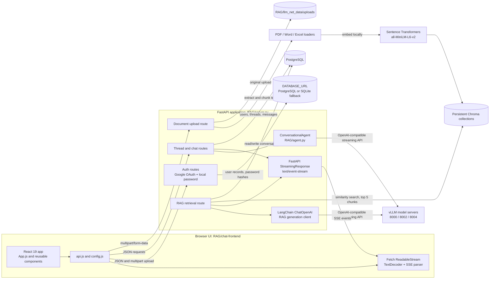
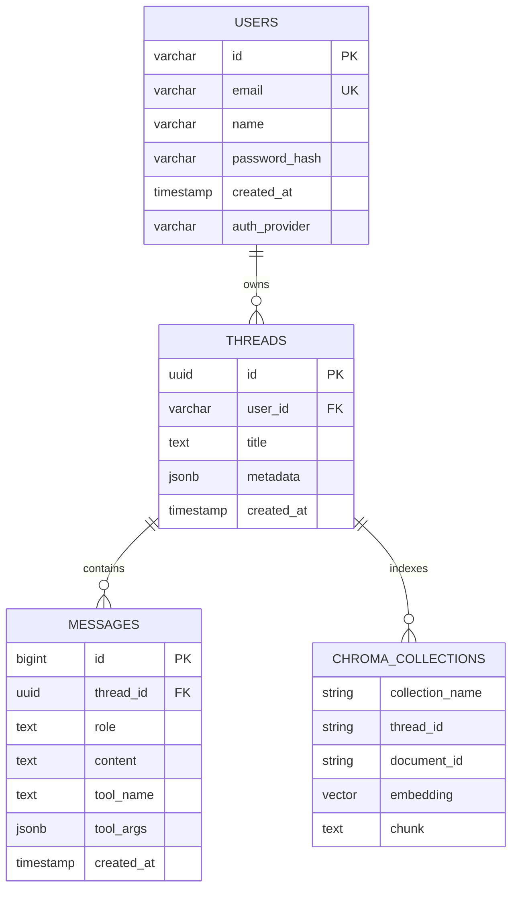

# Local LLM Chat and Document RAG

A final-year project that combines a React chat interface, a FastAPI backend, locally hosted OpenAI-compatible LLM endpoints, and retrieval-augmented generation (RAG) over uploaded documents. The main application backend is [`RAG/server.py`](RAG/server.py).

The chat UI and embeddings run locally. LLM inference is provided by separate vLLM-compatible services; this repository does not download model weights or start those model servers.

## What it does

- Provides a browser chat UI with conversation threads and streamed responses.
- Supports regular chat and document-grounded Q&A.
- Accepts PDF, DOC/DOCX, and XLS/XLSX files through the backend document processor.
- Extracts and chunks content, creates embeddings with the local `all-MiniLM-L6-v2` Sentence Transformers model, and stores per-document vectors in Chroma.
- Retrieves the five closest chunks for a RAG query and sends the context to the selected vLLM endpoint.
- Stores users, threads, and messages in PostgreSQL (with a SQLite fallback for the separate auth SQLAlchemy connection).
- Offers local email/password registration and login, plus Google OAuth when configured.
- Exposes health and Prometheus metrics endpoints.

## Architecture



### Request flow

1. On startup the React app checks `/api/user/me` with cookies enabled. It then loads the user's thread list and creates/selects a thread through the chat API.
2. For plain chat, the UI posts JSON to `/chat/send`. The backend saves the user message, loads history from PostgreSQL, formats it into OpenAI chat roles, and calls `ConversationalAgent`.
3. For document chat, the browser sends a multipart upload to `/chat/upload_doc`. The backend saves the original file, extracts and chunks its contents, embeds the chunks locally, and persists a Chroma collection at `RAG/llm_net_data/vectorstores/<thread_id>/<document_id>`.
4. The UI posts the question and document ID to `/chat/rag`. The backend retrieves the five closest chunks, combines them with conversation history, and calls the selected model endpoint.
5. For either chat mode, the model response streams back while the backend stores the completed assistant response in the thread history. PostgreSQL conversation data, uploaded files, and Chroma vectors are separate storage layers.

### UI stack

The frontend is a Create React App project using React 19. `src/App.js` coordinates login state, thread selection, active messages, model selection, uploads, and response streaming. Reusable components under `src/components/` render the login view, sidebar, chat input, message bubbles, profile panel, and notifications. `src/api.js` centralizes HTTP requests, while `src/config.js` supplies API URLs and model/file settings.

The interface uses `lucide-react` for icons, `react-markdown` with GFM support for formatted assistant messages, and syntax highlighting for code. `MessageList.js` switches to `react-window` virtualization for long conversations; the `Orb` and `LiquidEther` components use `ogl`/Three.js visual effects. React state holds the current session, selected thread, message list, and selected document. An `AbortController` lets the user stop an in-progress response.

### Server-Sent Events (SSE) streaming

The backend uses FastAPI `StreamingResponse` with the `text/event-stream` media type for both `/chat/send` and `/chat/rag`. Each event is emitted as a `data:` line followed by a blank line. Normal chat events carry JSON such as `{"token":"..."}` or `{"reasoning_content":"..."}`; RAG emits token events. A final `data: [DONE]` marks successful completion, and a JSON error event reports a stream failure.

The model connection is itself streamed: `RAG/agent.py` reads the vLLM OpenAI-compatible chat-completions stream and forwards each content or reasoning delta to FastAPI. In the browser, `src/App.js` uses `fetch` rather than `EventSource` because requests are POSTs with JSON bodies. It reads the response `ReadableStream` with `getReader()` and `TextDecoder`, parses SSE `data:` lines, and incrementally updates the visible assistant message. On successful completion, the backend writes the full assistant answer to PostgreSQL; the user prompt is stored before generation begins. This makes text appear as it is generated instead of waiting for the entire answer.

### Relational data model

Auth and chat share a `users` table when `DATABASE_URL` and `POSTGRES_*` point to the same PostgreSQL database. Each user owns zero or more threads; each thread contains zero or more messages. Messages can optionally store tool metadata. Uploaded document contents and embeddings are not stored in these tables: originals live in the upload directory and chunks/vectors live in Chroma.



The `CHROMA_COLLECTIONS` entity is conceptual: Chroma manages its own collection files and IDs; it is not a PostgreSQL table. A collection is named from the thread and document IDs, and the persisted directory is nested by those IDs.

## Repository map

| Path | Purpose |
| --- | --- |
| `RAG/server.py` | FastAPI entry point: auth, chat, upload, RAG, health, metrics, and SSE routes |
| `RAG/agent.py` | Async streaming client for vLLM-compatible chat-completions APIs |
| `RAG/dbhelper.py` | PostgreSQL operations for users, threads, titles, and messages |
| `RAG/wordloader.py`, `RAG/pdfloader.py`, `RAG/excel_loader.py` | Document extraction and chunking |
| `RAG/vectorestore.py` | Local embedding initialization and persistent Chroma collections |
| `RAG/chat-frontend/` | React application and API client |
| `auth/` | Example environment configuration and legacy auth-related files; active auth routes are in `RAG/server.py` |
| `requirements.txt` | Python backend dependencies |

## Local setup

### Requirements

- Python 3.10+ recommended (the checked-in launcher scripts refer to a machine-specific Python 3.9 install; use the commands below instead).
- Node.js and npm for the React frontend.
- PostgreSQL for chat threads and messages. The expected database name defaults to `LLMNET`.
- One or more separately running vLLM or compatible OpenAI API servers for model inference.
- Tesseract OCR installed and available on `PATH` if scanned PDF OCR is needed.

### 1. Configure the backend

From the repository root, create a virtual environment and install Python dependencies:

```powershell
py -m venv .venv
.\.venv\Scripts\Activate.ps1
python -m pip install --upgrade pip
pip install -r requirements.txt
```

Copy the example settings file and fill in your local values:

```powershell
Copy-Item auth\.env.example auth\.env
```

At minimum, set a unique `SESSION_SECRET_KEY`, PostgreSQL credentials (`POSTGRES_*`), and the matching `DATABASE_URL`. For Google sign-in, set `GOOGLE_CLIENT_ID` and `GOOGLE_CLIENT_SECRET`, and register `http://localhost:9096/callback` as an authorized redirect URI in Google OAuth configuration. Set `ALLOWED_DOMAIN` to the email domain allowed to register.

The auth SQLAlchemy connection uses `DATABASE_URL` (and falls back to a local `app.db` SQLite file if unset). Chat/thread storage in `RAG/dbhelper.py` uses the `POSTGRES_*` variables and requires PostgreSQL.

The PostgreSQL database must already contain the chat tables. The backend creates the auth `users` table through SQLAlchemy, but `dbhelper.py` does not create the chat tables. The expected chat schema is:

```sql
-- SQLAlchemy creates an equivalent users table from the User model in
-- RAG/server.py when the backend starts.
CREATE TABLE IF NOT EXISTS users (
    id VARCHAR(36) PRIMARY KEY,
    email VARCHAR(120) NOT NULL UNIQUE,
    name VARCHAR(120) NOT NULL,
    password_hash VARCHAR(256),
    created_at TIMESTAMP DEFAULT CURRENT_TIMESTAMP,
    auth_provider VARCHAR(50) DEFAULT 'google'
);

CREATE TABLE IF NOT EXISTS threads (
    id UUID PRIMARY KEY,
    user_id VARCHAR(36) NOT NULL REFERENCES users(id),
    title TEXT NOT NULL,
    metadata JSONB NOT NULL DEFAULT '{}'::jsonb,
    created_at TIMESTAMP NOT NULL DEFAULT CURRENT_TIMESTAMP
);

CREATE TABLE IF NOT EXISTS messages (
    id BIGSERIAL PRIMARY KEY,
    thread_id UUID NOT NULL REFERENCES threads(id) ON DELETE CASCADE,
    role TEXT NOT NULL,
    content TEXT NOT NULL,
    tool_name TEXT,
    tool_args JSONB,
    created_at TIMESTAMP NOT NULL DEFAULT CURRENT_TIMESTAMP
);
```

The `users` table is created by the auth model and includes `id`, `email`, `name`, `password_hash`, `created_at`, and `auth_provider` columns. Use the same PostgreSQL database for `DATABASE_URL` and the `POSTGRES_*` settings so auth users and chat threads share user IDs.

### 2. Start the vLLM services

Start your model servers separately with OpenAI-compatible endpoints. Defaults expected by the backend are:

| Model key | Endpoint | Default model identifier |
| --- | --- | --- |
| `llama` | `http://127.0.0.1:8000/v1` | `./meta-llama/Llama-3.1-8B-Instruct-awq` |
| `deepseek` | `http://127.0.0.1:8002/v1` | `./DeepSeek-Coder-V2-Lite-Instruct-awq` |
| `gpt-oss` | `http://127.0.0.1:8004/v1` | `openai/gpt-oss-20b` |

Set `LLAMA_API_URL`, `DEEPSEEK_API_URL`, and `GPT_OSS_API_URL` in `auth/.env` if your vLLM servers use different hosts or ports. The configured model identifier must match the identifier served by vLLM. `YOUR_API_KEY` is sent as a bearer token; align it with your vLLM server configuration.

### 3. Run the FastAPI backend

Run from the `RAG` directory because document and Chroma data paths are relative to the working directory:

```powershell
Set-Location RAG
python -m uvicorn server:app --host 0.0.0.0 --port 9096 --reload
```

The API is available at `http://localhost:9096`; interactive API docs are at `http://localhost:9096/docs`. A successful `/health` response confirms the API process is running, but does not verify database or model-server connectivity.

### 4. Run the React frontend

In a second terminal:

```powershell
Set-Location RAG\chat-frontend
npm install
npm start
```

The frontend uses `http://localhost:9096` by default. Override with `REACT_APP_API_BASE_URL` and `REACT_APP_AUTH_API_URL` when running the frontend against another backend. Set these variables before starting the React development server.

## API overview

| Method and path | Purpose |
| --- | --- |
| `GET /health` | Backend health check |
| `GET /login`, `GET /callback`, `GET /logout` | Google OAuth flow and session logout |
| `POST /api/register`, `POST /api/login` | Local email/password auth |
| `GET /api/user/me` | Current session user details |
| `POST /api/update-password` | Update a local password |
| `POST /chat/create_thread`, `GET /chat/threads`, `GET /chat/history` | Conversation thread and history operations |
| `POST /chat/send` | Stream a normal chat response as SSE |
| `POST /chat/upload_doc` | Upload, process, embed, and persist a document |
| `POST /chat/rag` | Retrieve document context and stream an answer as SSE |
| `GET /metrics` | Prometheus metrics exported by the FastAPI instrumentator |

The code also contains vector-store diagnostics and RAG-history routes. `/chat/agentic_rag` currently returns an unimplemented response.

## Authentication and security notes

Auth uses Starlette signed-cookie sessions. Google OAuth is handled by Authlib, local passwords are hashed with Passlib, and a configured `ALLOWED_DOMAIN` restricts the email domain used for OAuth and registration. The browser sends credentials for the session check and local login.

**This codebase needs additional access-control work before being exposed to a network or real users.** The chat, upload, history, and thread endpoints do not consistently require a signed-in session or verify that the requested thread belongs to that user. `/api/update-password` accepts an email in the request body instead of deriving it from the authenticated session. The session secret has a weak development fallback if not set. Configure secrets and restrict network access while addressing these issues; do not rely on the UI login screen as backend authorization.

The former repository tracked `auth/.env`; this fresh repository ignores that file and includes only `auth/.env.example`. If the old credentials were ever pushed to a remote, deleting local Git history does not remove them from that remote or other clones. Rotate exposed OAuth, database, and model API credentials.

## Local data and Git

Uploads, Chroma databases/vector stores, local databases, environment files, Python caches, and `node_modules` are excluded by `.gitignore`. They remain local and are not needed for a clean source checkout. Uploaded documents and vector stores are runtime data; back them up separately if you need to keep them.

The main backend expects vLLM endpoints and PostgreSQL to be available. This README describes the checked-in implementation; it does not imply that external model services, database schemas, or credentials are provisioned by the application.
